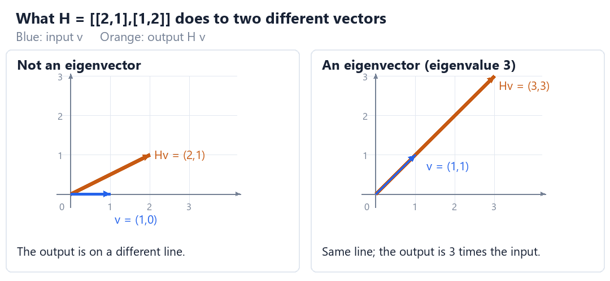
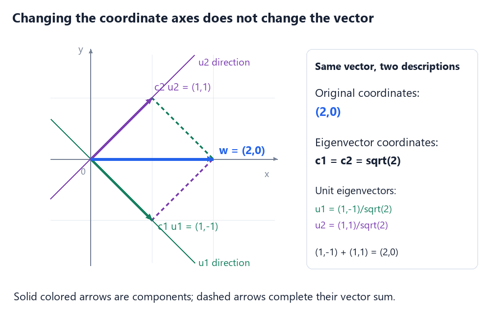

# Assignment 1 — Question 3: understanding quadratic gradient descent from the beginning

**Scope:** main Question 3, not the ReLU subquestion 2.3. This one note covers the prerequisites, the requested induction proof, and convergence.

**This version assumes no previous knowledge of eigenvectors or eigenvalues.** The aim is not just to state the formulas: it is to explain the objects, perform the calculations, and say why each new line follows from the preceding line.

- [Previous: Question 2.3 — ReLU and alternatives](../question2/03-relu-and-variants.md)
- [Earlier update-rule reminder: Question 1.5](../question1/05-gradient-descent-update.md)
- [Assignment statement and answer template](../../../../Assigments/IFT6135_A26__Student_/assignment1/en/assignment1_theory_en.tex)

These are study notes. **Question 3 is now fully answered in the LaTeX file.**

## 1. Reading guide: do not start with the final formula

The question combines several ideas. If a prerequisite is unfamiliar, the final proof can look like a sequence of unexplained substitutions.

Read it in these stages:

1. **Sections 2–3:** what a matrix does to a vector, and what an eigenvector/eigenvalue means.
2. **Sections 4–5:** lengths, perpendicular directions, bases, and coordinates along an eigenvector.
3. **Sections 6–9:** the error vector, transpose versus square, explicit derivatives, the Hessian, and rewriting the loss as scalar squares.
4. **Sections 10–12:** gradient descent, exactly where the identity matrix comes from, the scalar recurrence, and the induction proof.
5. **Sections 13–15:** convergence, the learning-rate condition, and complete numerical examples.

Each of those stages answers a different question. You do not need to absorb all of them in one reading.

The overall problem is: **if we repeatedly update the weights using the gradient of a quadratic loss, how close are the weights to their optimum after a given number of updates?** Eigenvectors provide directions in which that question becomes a one-variable calculation.

## 2. Start with vectors and matrix multiplication

### 2.1 A vector contains coordinates

For example,

$$
\mathbf v=\begin{bmatrix}1\\1\end{bmatrix}
$$

has two entries. Geometrically, we can draw it as an arrow from the origin to the point $(1,1)$: one unit horizontally and one unit vertically.

Multiplying by a scalar multiplies every entry:

$$
3\mathbf v=\begin{bmatrix}3\\3\end{bmatrix}.
$$

This makes the arrow three times as long, while keeping it on the same line through the origin.

In this assignment, the coordinates are parameters rather than physical positions. Drawing arrows in a two-parameter example is a way to visualize the mathematics.

### 2.2 A matrix transforms a vector

Use the following matrix as our running example:

$$
\mathbf H=\begin{bmatrix}2&1\\1&2\end{bmatrix}.
$$

For any input vector,

$$
\mathbf H\begin{bmatrix}a\\b\end{bmatrix}
=\begin{bmatrix}2a+b\\a+2b\end{bmatrix}.
$$

The first output is the first matrix row dotted with the input. The second output uses the second row.

Notice that both output entries generally involve both input entries. A matrix can mix coordinates, not just multiply the whole vector by one number.

For example,

$$
\mathbf H\begin{bmatrix}1\\0\end{bmatrix}
=\begin{bmatrix}2\cdot1+1\cdot0\\1\cdot1+2\cdot0\end{bmatrix}
=\begin{bmatrix}2\\1\end{bmatrix}.
$$

The input arrow is horizontal, but the output arrow is not. This transformation has changed its direction.

## 3. What exactly is an eigenvector?

### 3.1 Definition in words

An **eigenvector** is a special, nonzero input vector that a matrix transforms into a scalar multiple of itself.

Instead of being sent to a different line through the origin, it stays on its original line. The associated **eigenvalue** is the scalar multiplier.

The mathematical definition is

$$
\boxed{\mathbf H\mathbf u=\eta\mathbf u,\qquad\mathbf u\ne\mathbf0.}
$$

Read this as:

> Apply the matrix to the vector. The answer is the same vector multiplied by the number eta.

Here:

- $\mathbf H$ is a matrix;
- $\mathbf u$ is the eigenvector;
- $\eta$ is the eigenvalue, a scalar number.

The scalar can stretch or shrink the vector. For a general matrix, a negative eigenvalue reverses the arrow and a zero eigenvalue maps it to zero. In **this assignment**, positive definiteness will make all Hessian eigenvalues positive.

### 3.2 First complete example: eigenvalue 3

Try the vector $(1,1)$:

$$
\begin{aligned}
\mathbf H\begin{bmatrix}1\\1\end{bmatrix}
&=\begin{bmatrix}2\cdot1+1\cdot1\\1\cdot1+2\cdot1\end{bmatrix}\\
&=\begin{bmatrix}3\\3\end{bmatrix}\\
&=3\begin{bmatrix}1\\1\end{bmatrix}.
\end{aligned}
$$

The output is exactly three times the input. Therefore:

- $(1,1)$ is an eigenvector;
- its eigenvalue is 3.

We did not use the word “eigenvector” to make this happen. We multiplied the matrix by a candidate vector, checked the result, and observed the defining property.

### 3.3 Second complete example: eigenvalue 1

Now try $(1,-1)$:

$$
\begin{aligned}
\mathbf H\begin{bmatrix}1\\-1\end{bmatrix}
&=\begin{bmatrix}2\cdot1+1\cdot(-1)\\1\cdot1+2\cdot(-1)\end{bmatrix}\\
&=\begin{bmatrix}1\\-1\end{bmatrix}\\
&=1\begin{bmatrix}1\\-1\end{bmatrix}.
\end{aligned}
$$

This vector is unchanged. That still counts: multiplying by 1 is a scalar rescaling.

Thus $(1,-1)$ is another eigenvector, with eigenvalue 1.

### 3.4 Why was $(1,0)$ not an eigenvector?

We found that its output is $(2,1)$. Could this equal $\eta(1,0)$ for some number $\eta$?

That would require

$$
\begin{bmatrix}2\\1\end{bmatrix}
=\begin{bmatrix}\eta\\0\end{bmatrix}.
$$

The second entry would require $1=0$, which is impossible. So the vector is not an eigenvector of this matrix.

Being an eigenvector is a property **relative to a particular matrix**. A vector can be an eigenvector of one matrix and not of another.

### 3.5 Eigenvectors describe directions, not unique lengths

If $\mathbf H\mathbf u=\eta\mathbf u$, then for any nonzero scalar $c$,

$$
\mathbf H(c\mathbf u)=c\mathbf H\mathbf u
=c\eta\mathbf u=\eta(c\mathbf u).
$$

Therefore, $c\mathbf u$ is also an eigenvector with the same eigenvalue. For our example, $(1,1)$, $(2,2)$, and $(1/\sqrt2,1/\sqrt2)$ describe the same eigenvector direction.

The zero vector is excluded because $\mathbf H\mathbf0=\eta\mathbf0$ for every $\eta$; it tells us nothing about a special direction.

**Checkpoint:** if $\mathbf H\mathbf v=5\mathbf v$ with $\mathbf v\ne0$, what is the eigenvector and what is the eigenvalue? The vector is $\mathbf v$; the eigenvalue is 5.

We do not need an eigenvector-finding algorithm for this assignment. The question gives the relation $\mathbf H\mathbf u_j=\eta_j\mathbf u_j$ and asks us to use it. The examples above explain what that relation means.

## 4. Length, perpendicularity, and an orthonormal basis

### 4.1 Vector length and a unit vector

The Euclidean length of a two-dimensional vector is

$$
\left\|\begin{bmatrix}a\\b\end{bmatrix}\right\|_2
=\sqrt{a^2+b^2}.
$$

For $(1,1)$ and $(1,-1)$, the length is $\sqrt2$.

A **unit vector** has length 1. To obtain one, divide a nonzero vector by its length. For our two eigenvector directions, choose

$$
\boxed{
\mathbf u_1=\frac1{\sqrt2}\begin{bmatrix}1\\-1\end{bmatrix},
\qquad
\mathbf u_2=\frac1{\sqrt2}\begin{bmatrix}1\\1\end{bmatrix}.
}
$$

For example,

$$
\|\mathbf u_1\|_2^2
=\left(\frac1{\sqrt2}\right)^2+
 \left(-\frac1{\sqrt2}\right)^2
=\frac12+\frac12=1.
$$

Normalizing does not change the eigenvector property, because it is just multiplication by a nonzero scalar. We still have

$$
\mathbf H\mathbf u_1=1\mathbf u_1,
\qquad\mathbf H\mathbf u_2=3\mathbf u_2.
$$

Our labels are therefore $\eta_1=1$ and $\eta_2=3$.

### 4.2 A transpose and a dot product

The transpose turns a column into a row:

$$
\begin{bmatrix}a\\b\end{bmatrix}^{\top}
=\begin{bmatrix}a&b\end{bmatrix}.
$$

Multiplying that row by another column gives the **dot product**:

$$
\begin{bmatrix}a&b\end{bmatrix}
\begin{bmatrix}c\\d\end{bmatrix}
=ac+bd.
$$

The result is one number, not a vector.

Two nonzero vectors are perpendicular, or **orthogonal**, if their dot product is zero. Check our eigenvectors:

$$
\mathbf u_1^\top\mathbf u_2
=\frac1{\sqrt2}\frac1{\sqrt2}
 +\left(-\frac1{\sqrt2}\right)\frac1{\sqrt2}
=\frac12-\frac12=0.
$$

### 4.3 What does “orthonormal” mean?

It combines two properties:

- **ortho:** different directions are perpendicular;
- **normal:** each vector is normalized to length 1.

Thus, for orthonormal vectors,

$$
\mathbf u_i^\top\mathbf u_j=
\begin{cases}
1,&i=j,\\
0,&i\ne j.
\end{cases}
$$

Dotting a unit vector with itself gives 1. Dotting it with a different perpendicular direction gives 0. We will use both facts later; they are the reason several cross terms disappear.

### 4.4 What is a basis?

A basis is a collection of independent directions that lets us express every vector uniquely as a combination of those directions.

The usual two-dimensional basis is horizontal and vertical:

$$
\begin{bmatrix}a\\b\end{bmatrix}
=a\begin{bmatrix}1\\0\end{bmatrix}
+b\begin{bmatrix}0\\1\end{bmatrix}.
$$

But those are not the only possible axes. We can instead measure along our two diagonal directions $\mathbf u_1$ and $\mathbf u_2$.

This is like rotating the coordinate rulers. **The vector itself does not change; the numbers used to describe it change.**

For a real symmetric matrix, the **spectral theorem** guarantees that we can choose a full orthonormal basis of eigenvectors. We use this theorem here; the assignment does not ask us to prove it. A real Hessian is symmetric, so it has the needed property. Not every arbitrary matrix has such an eigenbasis.

## 5. Coordinates along eigenvectors: what is $w_j$?

### 5.1 Why a dot product extracts a coordinate

Suppose a vector has the decomposition

$$
\mathbf w=c_1\mathbf u_1+c_2\mathbf u_2.
$$

Dot both sides with $\mathbf u_1$:

$$
\begin{aligned}
\mathbf u_1^\top\mathbf w
&=c_1\mathbf u_1^\top\mathbf u_1
 +c_2\mathbf u_1^\top\mathbf u_2\\
&=c_1\cdot1+c_2\cdot0\\
&=c_1.
\end{aligned}
$$

Likewise, $\mathbf u_2^\top\mathbf w=c_2$.

The perpendicular component contributes zero, while the component along the chosen unit direction remains. That is why this scalar dot product measures the coordinate in that direction.

The assignment calls these coordinates $w_j$:

$$
\boxed{w_j=\mathbf u_j^\top\mathbf w
=\mathbf w^\top\mathbf u_j.}
$$

The two dot-product orders give the same scalar. We are not claiming that arbitrary matrix products can be reordered.

### 5.2 A complete coordinate-change example

Take the vector

$$
\mathbf w=\begin{bmatrix}2\\0\end{bmatrix}.
$$

Its original coordinates are 2 and 0. Its eigenvector coordinates are

$$
\begin{aligned}
w_1&=\frac1{\sqrt2}\begin{bmatrix}1&-1\end{bmatrix}
\begin{bmatrix}2\\0\end{bmatrix}
=\frac2{\sqrt2}=\sqrt2,\\
w_2&=\frac1{\sqrt2}\begin{bmatrix}1&1\end{bmatrix}
\begin{bmatrix}2\\0\end{bmatrix}
=\frac2{\sqrt2}=\sqrt2.
\end{aligned}
$$

Check that these reconstruct the original vector:

$$
\begin{aligned}
w_1\mathbf u_1+w_2\mathbf u_2
&=\sqrt2\frac1{\sqrt2}\begin{bmatrix}1\\-1\end{bmatrix}
 +\sqrt2\frac1{\sqrt2}\begin{bmatrix}1\\1\end{bmatrix}\\
&=\begin{bmatrix}1\\-1\end{bmatrix}
 +\begin{bmatrix}1\\1\end{bmatrix}\\
&=\begin{bmatrix}2\\0\end{bmatrix}.
\end{aligned}
$$

So $w_1=w_2=\sqrt2$ in the eigenbasis even though the original entries were 2 and 0. **This distinction is essential in Question 3.**

### 5.3 The general formulas used later

With $n$ parameters and an orthonormal eigenbasis,

$$
\mathbf w=\sum_{j=1}^n w_j\mathbf u_j,
\qquad
\mathbf w^\star=\sum_{j=1}^n w_j^\star\mathbf u_j,
$$

where

$$
w_j=\mathbf u_j^\top\mathbf w,
\qquad
w_j^\star=\mathbf u_j^\top\mathbf w^\star.
$$

The star means the optimum, not a multiplication operation. The superscript $(k)$ used later means “after $k$ updates,” not “raise the vector to the power $k$.”

**Checkpoint:** for a unit eigenvector, the scalar coordinate is $w_j$. The actual vector component parallel to that eigenvector is $w_j\mathbf u_j$. These are different types of object: a number versus a vector.

## 6. Understand the loss before differentiating it

### 6.1 What is the error vector?

The assignment gives

$$
L(\mathbf w)=L_0+\frac12(\mathbf w-\mathbf w^\star)^\top
\mathbf H(\mathbf w-\mathbf w^\star).
$$

Define a shorter name:

$$
\boxed{\mathbf e:=\mathbf w-\mathbf w^\star.}
$$

This is simply the difference between the current weights and the optimum. We have not differentiated anything by introducing $\mathbf e$.

Substituting the abbreviation into the original expression gives

$$
L=L_0+\frac12\mathbf e^\top\mathbf H\mathbf e.
$$

The next task is to understand this product. Writing the shorter expression does **not** by itself establish the gradient.

### 6.2 Why is the result a scalar?

The dimensions are

$$
\underbrace{\mathbf e^\top}_{1\times n}
\underbrace{\mathbf H}_{n\times n}
\underbrace{\mathbf e}_{n\times1}
\quad\longrightarrow\quad1\times1.
$$

The transpose is needed to obtain a row on the left. Row–matrix–column multiplication returns one number, as a loss should.

### 6.3 The transpose is NOT a power of 2

These notations mean different things:

| Notation            | Meaning                                                      |
| ------------------- | ------------------------------------------------------------ |
| $\mathbf e^\top$    | Transpose the vector: column becomes row.                    |
| $e_i^2$             | Multiply the scalar entry $e_i$ by itself.                   |
| $\|\mathbf e\|_2^2$ | Squared Euclidean length, equal to the sum of entry squares. |
| $\mathbf e^{(k)}$   | Error vector after $k$ updates.                              |

We cannot replace $\mathbf e^\top\mathbf H\mathbf e$ by $\mathbf H\mathbf e^2$. A vector square in that expression is not the matrix operation we are using.

In one dimension, $e$ is a number, transposing it does not change it, and $ehe=he^2$. That scalar analogy is useful, but it does not authorize removing the transpose in the vector formula.

### 6.4 Expand the running example entry by entry

Temporarily let $e_1,e_2$ mean the **original entries** of the error vector, not its eigenvector coordinates:

$$
\mathbf e=\begin{bmatrix}e_1\\e_2\end{bmatrix},
\qquad
\mathbf H\mathbf e=
\begin{bmatrix}2e_1+e_2\\e_1+2e_2\end{bmatrix}.
$$

Multiply by the row $\mathbf e^\top$:

$$
\begin{aligned}
\mathbf e^\top\mathbf H\mathbf e
&=\begin{bmatrix}e_1&e_2\end{bmatrix}
\begin{bmatrix}2e_1+e_2\\e_1+2e_2\end{bmatrix}\\
&=e_1(2e_1+e_2)+e_2(e_1+2e_2)\\
&=2e_1^2+e_1e_2+e_2e_1+2e_2^2\\
&=2e_1^2+2e_1e_2+2e_2^2.
\end{aligned}
$$

Consequently, the loss for this matrix is

$$
\begin{aligned}
L&=L_0+\frac12(2e_1^2+2e_1e_2+2e_2^2)\\
&=\boxed{L_0+e_1^2+e_1e_2+e_2^2}.
\end{aligned}
$$

**Why “quadratic”?** Every nonconstant term has total degree 2: $e_1^2$ has two factors of $e_1$, and $e_1e_2$ has one factor of each variable. A quadratic can contain mixed products as well as squares.

For the identity matrix, $\mathbf e^\top\mathbf e=\sum_i e_i^2$. For a diagonal matrix, we obtain weighted entry squares. For a general symmetric matrix, we may also obtain mixed products. We will remove those mixed products by choosing the eigenbasis, not by deleting the transpose.

## 7. Actually compute the derivative: why is the gradient $\mathbf H\mathbf e$?

### 7.1 Which quantities are constant?

We differentiate with respect to the current weights. In this question:

- $L_0$ is a constant loss offset;
- $\mathbf H$ is a constant matrix;
- $\mathbf w^\star$ is the fixed optimum;
- $\mathbf w$ is the variable.

Thus $e_i=w_i-w_i^\star$ changes when its corresponding weight changes.

The gradient is the column vector of partial derivatives, one per original parameter entry. We must calculate those derivatives before identifying the resulting vector as $\mathbf H\mathbf e$.

### 7.2 First do the one-parameter derivative completely

For one scalar parameter, write

$$
L(w)=L_0+\frac12h(w-w^\star)^2.
$$

The chain rule gives

$$
\begin{aligned}
\frac{dL}{dw}
&=\frac{dL_0}{dw}
 +\frac12h\frac{d}{dw}(w-w^\star)^2\\
&=0+\frac12h\cdot2(w-w^\star)
 \cdot\frac{d}{dw}(w-w^\star)\\
&=\frac12h\cdot2(w-w^\star)\cdot(1-0)\\
&=h(w-w^\star).
\end{aligned}
$$

Each change has a reason:

1. The derivative of the **additive constant** $L_0$ is zero.
2. The constant coefficient $h/2$ stays outside the derivative.
3. Differentiating the square supplies the factor 2.
4. The inner derivative is 1 because $w^\star$ is constant.
5. The factor 2 cancels the factor $1/2$.

A constant by itself differentiates to zero. A constant **multiplying an expression that depends on the variable** remains as a coefficient. This is why $L_0$ disappears while $h$ remains.

### 7.3 Now calculate both partial derivatives in the two-parameter example

For our running matrix, we already expanded the loss to

$$
L=L_0+e_1^2+e_1e_2+e_2^2,
\qquad e_1=w_1-w_1^\star,
\qquad e_2=w_2-w_2^\star.
$$

**In this subsection only, $w_1,w_2$ are the original entries used for differentiation.** Later, the assignment's $w_j$ again denotes eigenvector coordinates.

When differentiating with respect to $w_1$, hold $w_2$ fixed. Therefore,

$$
\frac{\partial e_1}{\partial w_1}=1,
\qquad
\frac{\partial e_2}{\partial w_1}=0.
$$

Apply the chain rule to the squares and the product rule to the mixed term:

$$
\begin{aligned}
\frac{\partial L}{\partial w_1}
&=0+2e_1\frac{\partial e_1}{\partial w_1}
 +\frac{\partial e_1}{\partial w_1}e_2\\
&\quad+e_1\frac{\partial e_2}{\partial w_1}
 +2e_2\frac{\partial e_2}{\partial w_1}\\
&=0+2e_1\cdot1+1\cdot e_2+e_1\cdot0+2e_2\cdot0\\
&=2e_1+e_2.
\end{aligned}
$$

For $w_2$, the inner derivatives are reversed:

$$
\frac{\partial e_1}{\partial w_2}=0,
\qquad
\frac{\partial e_2}{\partial w_2}=1.
$$

Thus,

$$
\begin{aligned}
\frac{\partial L}{\partial w_2}
&=0+2e_1\cdot0+0\cdot e_2+e_1\cdot1+2e_2\cdot1\\
&=e_1+2e_2.
\end{aligned}
$$

Stack the two partial derivatives into the gradient:

$$
\begin{aligned}
\nabla L
&=\begin{bmatrix}2e_1+e_2\\e_1+2e_2\end{bmatrix}\\
&=\begin{bmatrix}2&1\\1&2\end{bmatrix}
\begin{bmatrix}e_1\\e_2\end{bmatrix}\\
&=\boxed{\mathbf H\mathbf e}.
\end{aligned}
$$

This is not a formula that appeared merely because we named the error $\mathbf e$. It is the result of performing the derivatives and recognizing the matrix product.

### 7.4 General calculation for $n$ parameters

The indexed calculation below is the same product rule for a larger matrix. Read the two-parameter example first if the sums are unfamiliar.

Expanding matrix multiplication gives

$$
L=L_0+\frac12\sum_{r=1}^n\sum_{s=1}^n e_rH_{rs}e_s.
$$

For the derivative with respect to the original entry $w_i$,

$$
\frac{\partial e_r}{\partial w_i}
=\begin{cases}1,&r=i,\\0,&r\ne i.\end{cases}
$$

The matrix entries are constant. The product rule differentiates the first error factor and then the second:

$$
\begin{aligned}
\frac{\partial L}{\partial w_i}
&=0+\frac12\sum_{r=1}^n\sum_{s=1}^n H_{rs}
\left(
\frac{\partial e_r}{\partial w_i}e_s
+e_r\frac{\partial e_s}{\partial w_i}
\right)\\
&=\frac12\sum_{s=1}^n H_{is}e_s
 +\frac12\sum_{r=1}^n H_{ri}e_r.
\end{aligned}
$$

Why did the double sums reduce?

- In the first contribution, only $r=i$ survives; every other derivative is zero.
- In the second contribution, only $s=i$ survives.
- If both indices equal $i$, both contributions are needed: they are precisely the two contributions to the derivative of $e_i^2$.

The Hessian is symmetric, so $H_{ri}=H_{ir}$. The summation label is just a temporary name; we can rename $r$ as $s$ in the second sum. Hence,

$$
\begin{aligned}
\frac{\partial L}{\partial w_i}
&=\frac12\sum_s H_{is}e_s
 +\frac12\sum_s H_{is}e_s\\
&=\sum_s H_{is}e_s\\
&=(\mathbf H\mathbf e)_i.
\end{aligned}
$$

Each gradient entry equals the corresponding entry of $\mathbf H\mathbf e$. Therefore,

$$
\boxed{\nabla L(\mathbf w)=\mathbf H\mathbf e
=\mathbf H(\mathbf w-\mathbf w^\star).}
$$

The gradient has shape $n\times1$, as does $(n\times n)(n\times1)$.

Without symmetry, the two sums would not necessarily be equal; the formula would be $(\mathbf H+\mathbf H^\top)\mathbf e/2$. The simpler result uses a specific property of the Hessian, not a general rule for every matrix.

## 8. What is the Hessian, and what does curvature mean?

### 8.1 First versus second derivatives

A first derivative describes a slope. A second derivative describes how that slope changes: this is curvature.

For the scalar loss from Section 7.2,

$$
\frac{dL}{dw}=h(w-w^\star),
\qquad
\frac{d^2L}{dw^2}=h.
$$

A larger positive $h$ means that the gradient grows more quickly as we move away from the optimum. The bowl is steeper in that direction.

With multiple parameters, the Hessian collects the second partial derivatives:

$$
\mathbf H=
\begin{bmatrix}
\frac{\partial^2L}{\partial w_1^2}
&\frac{\partial^2L}{\partial w_1\partial w_2}\\
\frac{\partial^2L}{\partial w_2\partial w_1}
&\frac{\partial^2L}{\partial w_2^2}
\end{bmatrix}.
$$

Our explicit gradient was $(2e_1+e_2,e_1+2e_2)$. Differentiating its entries again gives the matrix with diagonal entries 2 and off-diagonal entries 1. This checks why the matrix in the loss is called its Hessian.

### 8.2 What does positive definite mean?

It means

$$
\mathbf v^\top\mathbf H\mathbf v>0
\qquad\text{for every nonzero vector }\mathbf v.
$$

Consequently, when $\mathbf w\ne\mathbf w^\star$, the error is nonzero and

$$
L(\mathbf w)-L_0=\frac12\mathbf e^\top\mathbf H\mathbf e>0.
$$

At the optimum, $\mathbf e=0$ and $L(\mathbf w^\star)=L_0$. So $L_0$ is the minimum loss, not necessarily the loss at the initial weights.

For a unit eigenvector,

$$
\mathbf u_j^\top\mathbf H\mathbf u_j
=\mathbf u_j^\top(\eta_j\mathbf u_j)
=\eta_j\underbrace{\mathbf u_j^\top\mathbf u_j}_{1}
=\eta_j.
$$

Positive definiteness makes the left side positive, so every $\eta_j>0$.

### 8.3 Why an eigenvalue is a directional curvature

Move away from the optimum only along the unit direction $\mathbf u_j$:

$$
\mathbf w=\mathbf w^\star+t\mathbf u_j.
$$

Here $t$ is the scalar distance in that direction, and $\mathbf e=t\mathbf u_j$. Substitute into the loss:

$$
\begin{aligned}
L(\mathbf w^\star+t\mathbf u_j)
&=L_0+\frac12(t\mathbf u_j)^\top\mathbf H(t\mathbf u_j)\\
&=L_0+\frac12t^2\mathbf u_j^\top\mathbf H\mathbf u_j\\
&=\boxed{L_0+\frac12\eta_jt^2}.
\end{aligned}
$$

This is an ordinary one-variable parabola. Its second derivative with respect to $t$ is $\eta_j$. That is the precise meaning of “curvature along an eigenvector.”

## 9. Can we use a loss with powers of 2? Yes, in the right coordinates

### 9.1 Define the error coordinates

In the eigenbasis, let

$$
\epsilon_j:=\mathbf u_j^\top\mathbf e
=\mathbf u_j^\top(\mathbf w-\mathbf w^\star)
=w_j-w_j^\star.
$$

Then

$$
\mathbf e=\sum_j\epsilon_j\mathbf u_j.
$$

The $\epsilon_j$ are scalar errors along eigenvector directions. They are not necessarily the original entries $e_i$ used in the previous derivative calculation.

### 9.2 Show why the mixed terms disappear

In two dimensions,

$$
\mathbf e=\epsilon_1\mathbf u_1+\epsilon_2\mathbf u_2.
$$

Apply the matrix and use the eigenvector property:

$$
\begin{aligned}
\mathbf H\mathbf e
&=\epsilon_1\mathbf H\mathbf u_1
 +\epsilon_2\mathbf H\mathbf u_2\\
&=\eta_1\epsilon_1\mathbf u_1
 +\eta_2\epsilon_2\mathbf u_2.
\end{aligned}
$$

Multiplying the error row by this column gives four terms:

$$
\begin{aligned}
\mathbf e^\top\mathbf H\mathbf e
&=\eta_1\epsilon_1^2\mathbf u_1^\top\mathbf u_1
 +\eta_2\epsilon_2^2\mathbf u_2^\top\mathbf u_2\\
&\quad+\eta_2\epsilon_1\epsilon_2\mathbf u_1^\top\mathbf u_2
 +\eta_1\epsilon_1\epsilon_2\mathbf u_2^\top\mathbf u_1\\
&=\eta_1\epsilon_1^2\cdot1+\eta_2\epsilon_2^2\cdot1
 +0+0\\
&=\boxed{\eta_1\epsilon_1^2+\eta_2\epsilon_2^2}.
\end{aligned}
$$

We used unit lengths for the first two terms and perpendicularity for the cross terms. This is why an orthonormal eigenbasis matters.

In $n$ dimensions, expanding the two sums gives

$$
\begin{aligned}
\mathbf e^\top\mathbf H\mathbf e
&=\sum_{i=1}^n\sum_{j=1}^n
 \epsilon_i\epsilon_j\eta_j\mathbf u_i^\top\mathbf u_j\\
&=\sum_{j=1}^n\eta_j\epsilon_j^2.
\end{aligned}
$$

Every term with $i\ne j$ is zero because the directions are perpendicular. Only the terms with $i=j$ remain, and their dot products equal 1. Substitute $\epsilon_j=w_j-w_j^\star$ into the loss:

$$
\boxed{
L=L_0+\frac12\sum_{j=1}^n\eta_j(w_j-w_j^\star)^2.
}
$$

**We have not deleted a transpose. We have evaluated the quadratic product using coordinates in which the matrix acts by separate scalar multipliers.**

### 9.3 Differentiate the scalar-coordinate version

Now $w_j$ refers to the assignment's eigenvector coordinate. Other coordinates are held fixed when taking its partial derivative. Their loss terms contribute zero.

$$
\begin{aligned}
\frac{\partial L}{\partial w_j}
&=0+\frac12\eta_j
\frac{\partial}{\partial w_j}(w_j-w_j^\star)^2\\
&=\frac12\eta_j\cdot2(w_j-w_j^\star)\cdot1\\
&=\boxed{\eta_j(w_j-w_j^\star)}.
\end{aligned}
$$

This is the one-parameter derivative again, with $h$ replaced by the directional curvature $\eta_j$.

It agrees with the matrix gradient: since $\mathbf H\mathbf e=\sum_j\eta_j\epsilon_j\mathbf u_j$, its scalar component along $\mathbf u_j$ is exactly $\eta_j\epsilon_j$.

You can use this squared-coordinate route in the proof, provided you first explain the orthonormal eigenbasis rewrite. You cannot use $\mathbf H\mathbf e^2$ as a substitute for the original vector formula.

## 10. Gradient descent and the supposedly “random” identity matrix

### 10.1 Evaluate the gradient at the previous weights

One gradient-descent step is

$$
\mathbf w^{(k)}=\mathbf w^{(k-1)}
-\rho\nabla L(\mathbf w^{(k-1)}).
$$

Here:

- $k$ is the update number;
- $\rho$ is the learning rate;
- the gradient is evaluated **before** the update, at $\mathbf w^{(k-1)}$.

Substitute the derivative we actually calculated:

$$
\boxed{
\mathbf w^{(k)}=\mathbf w^{(k-1)}
-\rho\mathbf H(\mathbf w^{(k-1)}-\mathbf w^\star).
}
$$

The gradient points in a direction of increasing loss; a sufficiently small step with a minus sign moves in the opposite direction. The precise “sufficiently small” requirement comes in Section 14.

### 10.2 What is the identity matrix?

For two parameters,

$$
\mathbf I=\begin{bmatrix}1&0\\0&1\end{bmatrix}.
$$

Multiplication leaves a vector unchanged:

$$
\mathbf I\begin{bmatrix}a\\b\end{bmatrix}
=\begin{bmatrix}1a+0b\\0a+1b\end{bmatrix}
=\begin{bmatrix}a\\b\end{bmatrix}.
$$

For $n$ parameters, $\mathbf I$ is the $n\times n$ matrix with ones on the diagonal and zeros elsewhere. It is the matrix equivalent of multiplying a scalar by 1:

$$
\boxed{\mathbf I\mathbf v=\mathbf v.}
$$

### 10.3 Every line of the parameter-update factorization

Start from the update, distribute the matrix, insert the identity, and then factor:

$$
\begin{aligned}
\mathbf w^{(k)}
&=\mathbf w^{(k-1)}
 -\rho\mathbf H(\mathbf w^{(k-1)}-\mathbf w^\star)\\
&=\mathbf w^{(k-1)}
 -\rho\mathbf H\mathbf w^{(k-1)}
 +\rho\mathbf H\mathbf w^\star\\
&=\mathbf I\mathbf w^{(k-1)}
 -\rho\mathbf H\mathbf w^{(k-1)}
 +\rho\mathbf H\mathbf w^\star\\
&=\boxed{(\mathbf I-\rho\mathbf H)\mathbf w^{(k-1)}
 +\rho\mathbf H\mathbf w^\star}.
\end{aligned}
$$

What happened at each transition?

1. Matrix multiplication distributes over the vector difference.
2. The minus sign times the minus optimum term becomes a plus.
3. We write $\mathbf w^{(k-1)}$ as $\mathbf I\mathbf w^{(k-1)}$; these are equal.
4. Both terms now contain the same vector on the right, so we factor it out.

The identity is not a new assumption or an extra term in the algorithm. It is inserted to express an existing vector as a matrix times that vector.

**Shape check:** $\mathbf I$ and $\rho\mathbf H$ are both $n\times n$, so their difference is a matrix. A literal scalar 1 is not a replacement for $\mathbf I$ in this matrix subtraction.

### 10.4 Every line of the error-update factorization

Define the error at each update:

$$
\mathbf e^{(k)}:=\mathbf w^{(k)}-\mathbf w^\star.
$$

Subtract the optimum from the update:

$$
\begin{aligned}
\mathbf e^{(k)}
&=\mathbf w^{(k-1)}-\mathbf w^\star
 -\rho\mathbf H(\mathbf w^{(k-1)}-\mathbf w^\star)\\
&=\mathbf e^{(k-1)}-\rho\mathbf H\mathbf e^{(k-1)}\\
&=\mathbf I\mathbf e^{(k-1)}-\rho\mathbf H\mathbf e^{(k-1)}\\
&=\boxed{(\mathbf I-\rho\mathbf H)\mathbf e^{(k-1)}}.
\end{aligned}
$$

This is the vector counterpart of the scalar algebra

$$
e-\rho he=(1-\rho h)e.
$$

The vector version uses $\mathbf I$ where the scalar version uses 1.

### 10.5 Check the identity calculation numerically

For our running matrix and $\rho=1/4$,

$$
\rho\mathbf H=
\begin{bmatrix}\frac12&\frac14\\\frac14&\frac12\end{bmatrix},
\qquad
\mathbf I-\rho\mathbf H=
\begin{bmatrix}\frac12&-\frac14\\-\frac14&\frac12\end{bmatrix}.
$$

Take an old error $\mathbf e=(-2,0)^\top$. The unfactored calculation is

$$
\begin{aligned}
\mathbf e-\rho\mathbf H\mathbf e
&=\begin{bmatrix}-2\\0\end{bmatrix}
 -\frac14\begin{bmatrix}-4\\-2\end{bmatrix}\\
&=\begin{bmatrix}-1\\\frac12\end{bmatrix}.
\end{aligned}
$$

The factored calculation is

$$
\begin{bmatrix}\frac12&-\frac14\\-\frac14&\frac12\end{bmatrix}
\begin{bmatrix}-2\\0\end{bmatrix}
=\begin{bmatrix}-1\\\frac12\end{bmatrix}.
$$

Both forms produce exactly the same error. Factoring changed the notation, not the update.

## 11. Why eigenvectors simplify the update

### 11.1 The matrix error update is independent along eigenvectors

Apply the error-update matrix to an eigenvector:

$$
\begin{aligned}
(\mathbf I-\rho\mathbf H)\mathbf u_j
&=\mathbf I\mathbf u_j-\rho\mathbf H\mathbf u_j\\
&=\mathbf u_j-\rho\eta_j\mathbf u_j\\
&=\boxed{(1-\rho\eta_j)\mathbf u_j}.
\end{aligned}
$$

The Hessian scales this direction by $\eta_j$. The **update matrix** scales error in the same direction by $1-\rho\eta_j$. Those are different multipliers.

This is the reason for eigenvectors in the problem: they turn a matrix transformation into a separate scalar multiplier for each direction.

### 11.2 Projecting the full parameter update, with no skipped algebra

We need a row-vector identity. Transposing a product reverses the order of its factors. Thus transposing $\mathbf H\mathbf u_j=\eta_j\mathbf u_j$ gives

$$
\mathbf u_j^\top\mathbf H^\top=\eta_j\mathbf u_j^\top.
$$

Because the Hessian is symmetric, $\mathbf H^\top=\mathbf H$, so

$$
\boxed{\mathbf u_j^\top\mathbf H=\eta_j\mathbf u_j^\top.}
$$

Now take the dot product of the full update with $\mathbf u_j$:

$$
\begin{aligned}
w_j^{(k)}
&=\mathbf u_j^\top\mathbf w^{(k)}\\
&=\mathbf u_j^\top\mathbf w^{(k-1)}
 -\rho\mathbf u_j^\top\mathbf H
 (\mathbf w^{(k-1)}-\mathbf w^\star)\\
&=w_j^{(k-1)}
 -\rho\eta_j\mathbf u_j^\top
 (\mathbf w^{(k-1)}-\mathbf w^\star)\\
&=w_j^{(k-1)}-\rho\eta_j
 (w_j^{(k-1)}-w_j^\star)\\
&=w_j^{(k-1)}-\rho\eta_jw_j^{(k-1)}
 +\rho\eta_jw_j^\star\\
&=\boxed{(1-\rho\eta_j)w_j^{(k-1)}
 +\rho\eta_jw_j^\star}.
\end{aligned}
$$

Reasons, in the same order:

1. Define the eigenvector coordinate using a dot product.
2. Substitute the vector update and distribute the dot product.
3. Use the row-eigenvector identity to replace a matrix action by a scalar multiplier.
4. Recognize the old and optimum scalar coordinates.
5. Distribute the subtraction.
6. Collect the two terms containing the old coordinate.

We now have a **scalar recurrence**: a rule giving the next scalar coordinate from the previous one. No other direction's coordinate appears.

### 11.3 Name the factor and show that it multiplies the error

Define

$$
q_j:=1-\rho\eta_j,
\qquad 1-q_j=\rho\eta_j.
$$

The recurrence becomes

$$
w_j^{(k)}=q_jw_j^{(k-1)}+(1-q_j)w_j^\star.
$$

Subtract the target coordinate and simplify:

$$
\begin{aligned}
w_j^{(k)}-w_j^\star
&=q_jw_j^{(k-1)}+(1-q_j)w_j^\star-w_j^\star\\
&=q_jw_j^{(k-1)}+(1-q_j-1)w_j^\star\\
&=q_jw_j^{(k-1)}-q_jw_j^\star\\
&=\boxed{q_j(w_j^{(k-1)}-w_j^\star)}.
\end{aligned}
$$

It is the **error** that gets multiplied by $q_j$, not the parameter coordinate alone. The parameter recurrence also has an optimum-offset term.

The factor is the same at every iteration because the Hessian and the learning rate are constant.

## 12. Build and prove the formula by mathematical induction

### 12.1 What is induction, in plain words?

To prove a claim for all positive integer update counts:

1. Check it for the first update: the **base case**.
2. Temporarily assume it is true at an arbitrary update $k$: the **induction hypothesis**.
3. Use the recurrence to show it must then be true at update $k+1$: the **induction step**.

This is a domino argument. The first case works, and each working case implies that the next case works. It is stronger than checking just two or three numerical examples.

### 12.2 First see why a power appears

The initialization is $\mathbf w^{(0)}=0$. Every projection of the zero vector is zero, so $w_j^{(0)}=0$.

The first two updates are

$$
\begin{aligned}
w_j^{(1)}&=q_j\cdot0+(1-q_j)w_j^\star
=(1-q_j)w_j^\star,\\
w_j^{(2)}&=q_j(1-q_j)w_j^\star+(1-q_j)w_j^\star\\
&=(1-q_j)(q_j+1)w_j^\star\\
&=(1-q_j^2)w_j^\star.
\end{aligned}
$$

The last line is the difference-of-squares identity $(1-q)(1+q)=1-q^2$.

Alternatively, the error starts at $-w_j^\star$ and is multiplied by $q_j$ at each step. After $k$ multiplications, the factor is $q_j^k$. This motivates the target formula

$$
\boxed{w_j^{(k)}=(1-q_j^k)w_j^\star
=\left[1-(1-\rho\eta_j)^k\right]w_j^\star.}
$$

Now prove it explicitly, as the assignment requests.

### Base case: $k=1$

Use the zero initialization in the recurrence:

$$
\begin{aligned}
w_j^{(1)}
&=q_j\cdot0+(1-q_j)w_j^\star\\
&=(1-q_j)w_j^\star\\
&=\left[1-(1-\rho\eta_j)^1\right]w_j^\star.
\end{aligned}
$$

That is the proposed formula for one step. Starting at $k=1$ also avoids a discussion of a zeroth power when $q_j=0$; the initial $k=0$ vector is already specified.

### Induction hypothesis

Assume that for some $k\geq1$,

$$
w_j^{(k)}=(1-q_j^k)w_j^\star.
$$

We assume only the claim at this $k$ in order to prove the next case. We are not assuming that the result is already true for every iteration.

### Induction step

Start from the recurrence, not from the result we want:

$$
\begin{aligned}
w_j^{(k+1)}
&=q_jw_j^{(k)}+(1-q_j)w_j^\star\\
&=q_j(1-q_j^k)w_j^\star+(1-q_j)w_j^\star\\
&=(q_j-q_jq_j^k+1-q_j)w_j^\star\\
&=(q_j-q_j^{k+1}+1-q_j)w_j^\star\\
&=(1-q_j^{k+1})w_j^\star\\
&=\left[1-(1-\rho\eta_j)^{k+1}\right]w_j^\star.
\end{aligned}
$$

The individual operations are:

1. Substitute the induction hypothesis for $w_j^{(k)}$.
2. Distribute $q_j$ and collect the common factor $w_j^\star$.
3. Use $q_jq_j^k=q_j^{k+1}$.
4. Cancel $+q_j$ and $-q_j$.
5. Replace the abbreviation $q_j$ by its definition.

We have proved the next case. Therefore the formula holds for every $k\geq1$ and every eigenvector direction $j$.

### Why the initialization matters

For a general initial vector, the error formula gives

$$
w_j^{(k)}=w_j^\star+q_j^k(w_j^{(0)}-w_j^\star).
$$

The assignment sets $w_j^{(0)}=0$, so this reduces to $(1-q_j^k)w_j^\star$. Starting at the origin does **not** mean that the optimum is the origin.

## 13. What does convergence mean, and why does it happen?

### 13.1 Understand the powers before taking the limit

If $|q_j|<1$, repeated multiplication by $q_j$ shrinks magnitudes.

For example:

| Scalar factor | First four powers                       |
| ------------- | --------------------------------------- |
| $q=3/4$       | $0.75,\ 0.5625,\ 0.421875,\ 0.31640625$ |
| $q=-1/2$      | $-0.5,\ 0.25,\ -0.125,\ 0.0625$         |
| $q=-1$        | $-1,\ 1,\ -1,\ 1$                       |
| $q=2$         | $2,\ 4,\ 8,\ 16$                        |

The first two cases approach zero. A negative factor is allowed: the signs alternate, but magnitudes shrink. The last two cases do not approach zero.

### 13.2 Apply that fact to each coordinate

Our exact coordinate error is

$$
w_j^{(k)}-w_j^\star=-q_j^kw_j^\star.
$$

The target $w_j^\star$ is fixed. When $|q_j|<1$, $q_j^k\to0$, so

$$
w_j^{(k)}-w_j^\star\to0,
\qquad
\boxed{w_j^{(k)}\to w_j^\star.}
$$

Convergence means getting arbitrarily close as the number of updates grows. It does not usually mean arriving at the exact optimum after finitely many steps. The special case $q_j=0$ does reach that direction's target in one update.

### 13.3 Explain why coordinate convergence gives vector convergence

We have finitely many parameters and fixed basis vectors. Reconstruct the original vector:

$$
\begin{aligned}
\mathbf w^{(k)}-\mathbf w^\star
&=\sum_{j=1}^n(w_j^{(k)}-w_j^\star)\mathbf u_j\\
&\longrightarrow\sum_{j=1}^n0\mathbf u_j\\
&=\mathbf0.
\end{aligned}
$$

Every coefficient tends to zero, so their finite vector sum tends to zero. Hence

$$
\boxed{\mathbf w^{(k)}\to\mathbf w^\star.}
$$

This conclusion requires the stated shrinking-factor condition in every direction.

### 13.4 Optional: a bound on the complete error magnitude

Let $r=\max_j|q_j|<1$. Orthonormal coordinates preserve squared length, so

$$
\begin{aligned}
\|\mathbf w^{(k)}-\mathbf w^\star\|_2^2
&=\sum_j|q_j|^{2k}(w_j^\star)^2\\
&\leq r^{2k}\sum_j(w_j^\star)^2\\
&=r^{2k}\|\mathbf w^\star\|_2^2.
\end{aligned}
$$

Taking nonnegative square roots gives

$$
\boxed{\|\mathbf w^{(k)}-\mathbf w^\star\|_2
\leq r^k\|\mathbf w^\star\|_2.}
$$

This bound uses the given zero initialization. It quantifies the geometric decrease of the optimization error, not the undesirable shrinking of backpropagated gradients across network depth from Question 2.

## 14. Exactly how small must the learning rate be?

### 14.1 Solve the condition one operation at a time

The assignment's condition is

$$
|1-\rho\eta_j|<1.
$$

An absolute value below 1 means its argument lies strictly between $-1$ and 1:

$$
-1<1-\rho\eta_j<1.
$$

Subtract 1 from all three parts:

$$
-2<-\rho\eta_j<0.
$$

Multiply by $-1$. Both inequality directions reverse:

$$
2>\rho\eta_j>0,
\qquad\text{equivalently }0<\rho\eta_j<2.
$$

Divide by the positive eigenvalue $\eta_j$:

$$
\boxed{0<\rho<\frac2{\eta_j}.}
$$

### 14.2 Why does the largest eigenvalue matter?

The same learning rate is used for all directions. It must satisfy every direction's upper bound.

For our example, $\eta_1=1$ and $\eta_2=3$:

$$
0<\rho<2,
\qquad
0<\rho<\frac23.
$$

To satisfy both, we choose the more restrictive range $0<\rho<2/3$.

In general, let $\eta_{\max}=\max_j\eta_j$. The largest eigenvalue gives the smallest upper bound, so the common sufficient stability condition is

$$
\boxed{0<\rho<\frac{2}{\eta_{\max}}.}
$$

The largest-curvature direction limits how large a step we can take safely.

### 14.3 Interpret the different cases

For a direction with a nonzero initial error:

| Factor               | Behavior of the coordinate error                                    |
| -------------------- | ------------------------------------------------------------------- |
| $0<q_j<1$            | Shrinks without changing sign; approaches the target monotonically. |
| $q_j=0$              | Reaches that coordinate's optimum in one step.                      |
| $-1<q_j<0$           | Alternates around the optimum, with shrinking deviations.           |
| $q_j=-1$             | Alternates without shrinking.                                       |
| $q_j=1$              | Does not change.                                                    |
| $\lvert q_j\rvert>1$ | Grows in magnitude.                                                 |

For $\rho=1/4$ and eigenvalues 1 and 3, the factors are $3/4$ and $1/4$, both stable.

For $\rho=1/2$, they are $1/2$ and $-1/2$: one direction oscillates, but both still converge.

At $\rho=2/3$, the largest-curvature factor is $-1$, so a nonzero error there does not decay. For $\rho=3/4$, that factor is $-5/4$, and such an error grows.

A direction already at its optimum has zero error and stays there even with an unstable factor. Thus the all-directions condition is a guarantee for arbitrary initial errors; violating it does not force divergence when the unstable directions have exactly zero initial error.

### 14.4 Optional loss interpretation

Using the eigenbasis loss and the coordinate error $-q_j^kw_j^\star$,

$$
L(\mathbf w^{(k)})-L_0
=\frac12\sum_j\eta_jq_j^{2k}(w_j^\star)^2.
$$

When all $|q_j|<1$, each nonzero-error contribution shrinks. Coordinates can oscillate while the loss decreases because the quadratic depends on squared errors.

## 15. Complete worked examples

### 15.1 Running example: a matrix that mixes the original coordinates

Use

$$
\mathbf H=\begin{bmatrix}2&1\\1&2\end{bmatrix},
\quad\mathbf w^\star=\begin{bmatrix}2\\0\end{bmatrix},
\quad\rho=\frac14,
\quad\mathbf w^{(0)}=\begin{bmatrix}0\\0\end{bmatrix}.
$$

We already know the unit eigenvectors and eigenvalues:

$$
\mathbf u_1=\frac1{\sqrt2}\begin{bmatrix}1\\-1\end{bmatrix},
\quad\eta_1=1,
\qquad
\mathbf u_2=\frac1{\sqrt2}\begin{bmatrix}1\\1\end{bmatrix},
\quad\eta_2=3.
$$

The target coordinates are $w_1^\star=w_2^\star=\sqrt2$, and the initial coordinates are both zero.

**First update in the original coordinates:**

$$
\begin{aligned}
\nabla L(\mathbf w^{(0)})
&=\mathbf H(\mathbf w^{(0)}-\mathbf w^\star)\\
&=\begin{bmatrix}2&1\\1&2\end{bmatrix}
\begin{bmatrix}-2\\0\end{bmatrix}\\
&=\begin{bmatrix}-4\\-2\end{bmatrix},
\end{aligned}
$$

$$
\mathbf w^{(1)}
=\begin{bmatrix}0\\0\end{bmatrix}
-\frac14\begin{bmatrix}-4\\-2\end{bmatrix}
=\begin{bmatrix}1\\\frac12\end{bmatrix}.
$$

**Second update in the original coordinates:**

$$
\begin{aligned}
\mathbf w^{(1)}-\mathbf w^\star
&=\begin{bmatrix}-1\\\frac12\end{bmatrix},\\
\nabla L(\mathbf w^{(1)})
&=\begin{bmatrix}2&1\\1&2\end{bmatrix}
\begin{bmatrix}-1\\\frac12\end{bmatrix}
=\begin{bmatrix}-\frac32\\0\end{bmatrix},\\
\mathbf w^{(2)}
&=\begin{bmatrix}1\\\frac12\end{bmatrix}
-\frac14\begin{bmatrix}-\frac32\\0\end{bmatrix}
=\boxed{\begin{bmatrix}\frac{11}{8}\\\frac12\end{bmatrix}}.
\end{aligned}
$$

**Check the same second update using the formula:**

$$
q_1=\frac34,
\qquad q_2=\frac14,
$$

$$
\begin{aligned}
w_1^{(2)}&=\left[1-\left(\frac34\right)^2\right]\sqrt2
=\frac{7\sqrt2}{16},\\
w_2^{(2)}&=\left[1-\left(\frac14\right)^2\right]\sqrt2
=\frac{15\sqrt2}{16}.
\end{aligned}
$$

These are eigenvector coordinates, so reconstruct the original vector:

$$
\begin{aligned}
\mathbf w^{(2)}
&=w_1^{(2)}\mathbf u_1+w_2^{(2)}\mathbf u_2\\
&=\frac7{16}\begin{bmatrix}1\\-1\end{bmatrix}
 +\frac{15}{16}\begin{bmatrix}1\\1\end{bmatrix}\\
&=\begin{bmatrix}\frac{22}{16}\\\frac8{16}\end{bmatrix}
=\boxed{\begin{bmatrix}\frac{11}{8}\\\frac12\end{bmatrix}}.
\end{aligned}
$$

Both calculations agree. The original second entry stays at $1/2$ between these first two updates, while both eigenvector coordinates change. This shows why original-coordinate behavior and eigenvector-coordinate behavior should not be confused.

### 15.2 Easier numerical check: an already diagonal Hessian

Use

$$
\mathbf H=\begin{bmatrix}1&0\\0&3\end{bmatrix},
\qquad\mathbf w^\star=\begin{bmatrix}2\\-1\end{bmatrix},
\qquad\rho=\frac14,
\qquad\mathbf w^{(0)}=\begin{bmatrix}0\\0\end{bmatrix}.
$$

Here the usual horizontal and vertical axes are already eigenvectors, with eigenvalues 1 and 3. Original entries and eigenvector coordinates coincide.

The factors are again $q_1=3/4$, $q_2=1/4$.

The first gradient and update are

$$
\nabla L(\mathbf w^{(0)})
=\begin{bmatrix}1&0\\0&3\end{bmatrix}
\begin{bmatrix}-2\\1\end{bmatrix}
=\begin{bmatrix}-2\\3\end{bmatrix},
$$

$$
\mathbf w^{(1)}
=\begin{bmatrix}0\\0\end{bmatrix}
-\frac14\begin{bmatrix}-2\\3\end{bmatrix}
=\begin{bmatrix}\frac12\\-\frac34\end{bmatrix}.
$$

For the second update,

$$
\nabla L(\mathbf w^{(1)})
=\begin{bmatrix}1&0\\0&3\end{bmatrix}
\begin{bmatrix}-\frac32\\\frac14\end{bmatrix}
=\begin{bmatrix}-\frac32\\\frac34\end{bmatrix},
$$

$$
\mathbf w^{(2)}
=\begin{bmatrix}\frac12\\-\frac34\end{bmatrix}
-\frac14\begin{bmatrix}-\frac32\\\frac34\end{bmatrix}
=\begin{bmatrix}\frac78\\-\frac{15}{16}\end{bmatrix}.
$$

The formula gives the same numbers:

$$
w_1^{(2)}=\left[1-\left(\frac34\right)^2\right]2=\frac78,
\qquad
w_2^{(2)}=\left[1-\left(\frac14\right)^2\right](-1)
=-\frac{15}{16}.
$$

| Iteration $k$ | $w_1^{(k)}$     | $w_2^{(k)}$        |
| ------------- | --------------- | ------------------ |
| 0             | $0$             | $0$                |
| 1             | $1/2=0.5$       | $-3/4=-0.75$       |
| 2             | $7/8=0.875$     | $-15/16=-0.9375$   |
| 3             | $37/32=1.15625$ | $-63/64=-0.984375$ |
| Limit         | $2$             | $-1$               |

The second coordinate converges faster in this example because its error is multiplied by $1/4$ rather than $3/4$. Very small learning rates can make convergence slow; stability does not mean that the rate is fast.

## 16. Symbol reference and common mistakes

| Symbol            | Meaning and type                                                 |
| ----------------- | ---------------------------------------------------------------- |
| $\mathbf w$       | Current parameter vector, $n\times1$.                            |
| $\mathbf w^\star$ | Fixed optimum vector, $n\times1$.                                |
| $\mathbf w^{(k)}$ | Vector after $k$ updates; $(k)$ is a label, not a power.         |
| $\mathbf e^{(k)}$ | Error $\mathbf w^{(k)}-\mathbf w^\star$.                         |
| $L_0$             | Constant minimum-loss offset, not generally the initial loss.    |
| $\mathbf H$       | Constant symmetric positive-definite Hessian, $n\times n$.       |
| $\mathbf I$       | Identity matrix, $n\times n$; leaves vectors unchanged.          |
| $\mathbf u_j$     | Unit eigenvector direction, $n\times1$.                          |
| $\eta_j$          | Positive eigenvalue/curvature, a scalar.                         |
| $\rho$            | Learning rate, a scalar.                                         |
| $w_j$             | Scalar coordinate $\mathbf u_j^\top\mathbf w$ in the eigenbasis. |
| $\epsilon_j$      | Scalar eigenbasis error $w_j-w_j^\star$.                         |
| $q_j$             | Scalar error multiplier $1-\rho\eta_j$.                          |

In Question 1, $\eta$ meant the learning rate. In this question, the learning rate is $\rho$ and $\eta_j$ is an eigenvalue.

Common mistakes:

- Treating $\top$ as an ordinary exponent or replacing the quadratic product by $\mathbf H\mathbf e^2$.
- Assuming all vectors are eigenvectors of a given matrix.
- Thinking “unit” means that every entry must be 0 or 1.
- Reconstructing a vector using dot-product coefficients without the unit, perpendicular basis assumption.
- Confusing original entries with the assignment's eigenvector coordinates.
- Naming the error and immediately asserting the gradient without actually differentiating.
- Dropping a multiplicative coefficient just because it is constant.
- Introducing $\mathbf I$ without explaining that $\mathbf v=\mathbf I\mathbf v$.
- Evaluating the gradient at the new rather than the previous weights.
- Multiplying the coordinate by $q_j$ and forgetting the optimum-offset term.
- Omitting the base case or induction step.
- Assuming negative $q_j$ always means divergence; magnitude is what matters.
- Using a non-strict upper bound $\rho\leq2/\eta_{\max}$.

## 17. Self-check questions, with answers

Try answering before reading the explanation after each question.

**1. What does $\mathbf H\mathbf u=4\mathbf u$ mean?**

The matrix sends the nonzero vector to four times itself. It is an eigenvector with eigenvalue 4. The output stays on the same line through the origin.

**2. Is the transpose converted into a square?**

No. Transposing supplies a row. Matrix multiplication then produces products of error entries; multiplying an entry by itself produces a square. In an orthonormal eigenbasis, cross terms vanish and we get weighted scalar squares.

**3. Why does $L_0$ disappear but $\mathbf H$ remain when differentiating?**

$L_0$ is an additive constant. The matrix entries are multiplicative coefficients of terms involving the variable weights. Derivatives of those variable-dependent terms are not zero.

**4. Where does $\mathbf I$ come from?**

We rewrite the existing term $\mathbf e$ as $\mathbf I\mathbf e$ before factoring a shared right-hand vector. It is not a new term added to gradient descent.

**5. What does $w_j=\mathbf u_j^\top\mathbf w$ measure?**

The scalar coordinate along a unit eigenvector direction. Its associated vector component is $w_j\mathbf u_j$.

**6. Why can we analyze the directions separately?**

The Hessian multiplies each eigenvector direction by its own scalar eigenvalue. With an orthonormal eigenbasis, the quadratic has no cross terms between these coordinates. The scalar recurrence for direction $j$ involves only that direction's coordinate and target.

**7. Does $\mathbf w^{(0)}=0$ imply $\mathbf w^\star=0$?**

No. One is our chosen starting point; the other is the optimum determined by the loss.

**8. What must tend to zero for convergence?**

The errors, not the target parameters. Their factors are $q_j^k$, which tend to zero when every $|q_j|<1$.

## 18. What is included in the completed LaTeX answer?

The LaTeX answer uses the eigenbasis sum-of-squares route. It contains:

1. The orthonormal eigenbasis rewrite, explaining why the quadratic becomes a weighted sum of scalar squares.
2. The explicit scalar derivative, showing the constant-loss derivative and cancellation of the factor 1/2.
3. Projection of the gradient-descent update to obtain the scalar recurrence.
4. The base case at the first update, induction hypothesis, and full induction step.
5. The scalar limits, reconstruction of the vector limit, and equivalent learning-rate range.

The prerequisite definitions, illustrations, full derivative expansions, identity-matrix calculation, and numerical examples remain in these notes. The submitted proof does not need the identity-matrix factorization because it follows the scalar-coordinate route.

**Question 3 is fully answered in LaTeX.**
